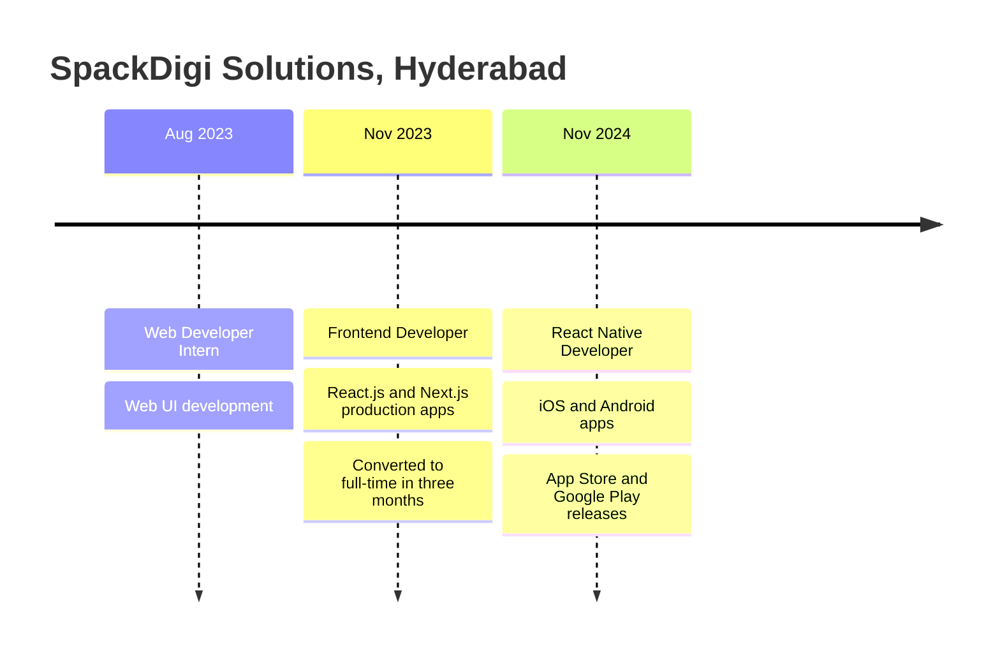

<div align="center">


<a href="https://vamshi-dev-portfolio.vercel.app/">
  
</a>

<br/>

[](https://vamshi-dev-portfolio.vercel.app/)
[](https://www.linkedin.com/in/vamshi-animela-449765221/)
[](mailto:vamshianimela.3@gmail.com)


</div>

<br/>

## 🧑‍💻 About me

```typescript
const vamshi = {
  role: "React Native Developer (iOS & Android)",
  company: "SpackDigi Solutions",
  location: "Hyderabad, India",
  experience: "3+ years",
  journey: ["Web Developer Intern", "Frontend Developer", "React Native Developer"],
  ships: ["App Store", "Google Play", "Vercel"],
  dailyDrivers: ["React Native", "TypeScript", "Next.js", "Redux"],
  freelance: { clients: 4, regions: ["UK", "India"] },
  languages: ["English", "Telugu", "Hindi"],
  openTo: ["Relocation", "Remote", "Freelance"],
};
```

- 📱 I take features from **UI and API integration all the way to store releases** on the App Store and Google Play
- 🧩 My work spans Redux and Context API state, REST and WebSocket integration, Google Maps, geolocation and payment flows
- 🌐 I also build **React.js and Next.js sites for freelance clients** in the UK and India, delivered end to end

<br/>

## 🚀 Featured work

<table>
  <tr>
    <td width="50%" valign="top">
      <h3>⚡ EV Charging Station Finder</h3>
      <p>Cross-platform app to discover, book and pay for EV charging stations with real-time availability.</p>
      <p><b>Highlight:</b> optimized map rendering and background API polling to improve responsiveness and reduce battery use.</p>
      <p>
        
        
        
        
      </p>
    </td>
    <td width="50%" valign="top">
      <h3>🎨 Poster Creation & Campaign Management</h3>
      <p>Create campaign posters and share them to WhatsApp, Instagram, Facebook and X in one tap.</p>
      <p><b>Highlight:</b> template editor with live preview and layering, role-based dashboards, multilingual profiles and subscription plans.</p>
      <p>
        
        
        
        
      </p>
    </td>
  </tr>
  <tr>
    <td width="50%" valign="top">
      <h3>📅 Venue Booking</h3>
      <p>Discover and book venues, filtered by location, price, capacity and amenities.</p>
      <p><b>Highlight:</b> WebSocket availability sync, optimistic UI updates, AsyncStorage caching and a drag-and-drop calendar.</p>
      <p>
        
        
        
      </p>
    </td>
    <td width="50%" valign="top">
      <h3>🛍️ Zylo E-commerce</h3>
      <p>E-commerce app interface with product browsing and shopping screens.</p>
      <p><b>Scope:</b> frontend only, no backend.</p>
      <p>
        
        
      </p>
    </td>
  </tr>
</table>

<br/>

## 🌐 Live client sites

| Client | What I built | Live |
| :-- | :-- | :-: |
| **Yasad Ltd** 🇬🇧 | Marketing site with services, testimonials and contact | [](https://yasad-project.vercel.app) |
| **SR Travels** 🇮🇳 | Travel, taxi and pilgrimage tour site with SEO meta tags and social previews | [](https://sr-travels-website.vercel.app) |
| **Sree Annapurna Cloud Kitchen** 🇮🇳 | Mobile-friendly cloud kitchen website | [](https://annapurna-cloud-kitchen.vercel.app) |
| **Manasvi Sketches** 🇮🇳 | Online portfolio for an artist's sketch work | [](https://manasvi-sketches.vercel.app) |

<br/>

## 🛠 Tech stack

<div align="center">

**Mobile & frontend**


**Platform & tools**


<br/><br/>


</div>

| Area | What I use |
| :-- | :-- |
| **Mobile** | React Native, Expo, React Navigation, native modules, animations and gestures |
| **Frontend** | React.js, Next.js, TypeScript, Tailwind CSS, Material UI, Styled Components, ShadCN UI |
| **State** | Redux, Context API, AsyncStorage |
| **Integration** | REST APIs, WebSockets, Axios, Google Maps, geolocation, payment gateways |
| **Quality** | Performance profiling, code splitting, lazy loading, SEO, ESLint, Prettier |

<br/>

## 💼 Career path



<details>
<summary><b>React Native Developer (iOS & Android)</b> · Nov 2024 – Present</summary>
<br/>

- Build cross-platform iOS and Android apps in React Native and TypeScript from a shared codebase
- Own features from UI and API integration through to production releases on both stores
- Debug platform-specific issues in Xcode and Android Studio, and contribute to code reviews in Agile sprints

</details>

<details>
<summary><b>Frontend Developer</b> · Nov 2023 – Nov 2024</summary>
<br/>

- Delivered production web applications with React.js and Next.js, responsive and SEO-optimized across devices
- Built reusable UI components with React Hooks, Tailwind CSS, Material UI and Styled Components
- Improved page load performance with code splitting and lazy loading

</details>

<details>
<summary><b>Web Developer Intern</b> · Aug 2023 – Nov 2023</summary>
<br/>

- Contributed to web UI development and was converted to a full-time role within three months

</details>

<br/>

## 📊 GitHub analytics

<div align="center">


</div>

<br/>

## 🐍 Contribution snake

<div align="center">
  <picture>
    <source media="(prefers-color-scheme: dark)" srcset="https://raw.githubusercontent.com/Vamshi5k/Vamshi5k/output/github-contribution-grid-snake-dark.svg" />
    
  </picture>
</div>

<br/>

## 🤝 Work with me

| Service | Details |
| :-- | :-- |
| 📱 **React Native & Expo apps** | iOS and Android from one TypeScript codebase |
| 🏢 **Business websites** | Next.js sites, delivered in as little as 3 days |
| 🛒 **E-commerce frontends** | Connected to your existing backend or API |
| 🎯 **Landing pages** | For a product, service or campaign |
| 🔧 **Fixes, features & performance** | For existing React and React Native apps |

<div align="center">

[](https://vamshi-dev-portfolio.vercel.app/#services)
[](mailto:vamshianimela.3@gmail.com)

</div>

<br/>

## 🎓 Education

**B.Tech, Electronics and Communication Engineering** · Annamacharya Institute of Technology and Sciences · 2022
**Certificate:** Frontend Developer, Ace Web Academy

<div align="center">

### Have an idea? Let's make it real.


</div>
